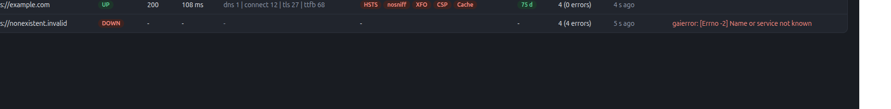
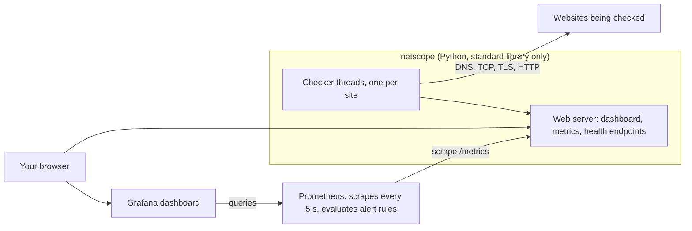
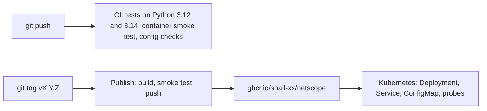
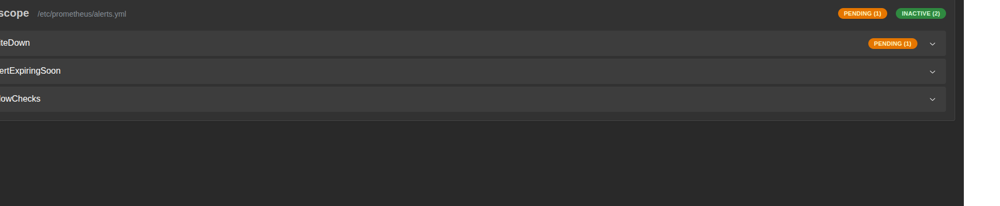
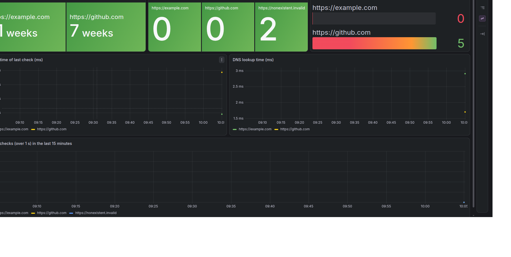
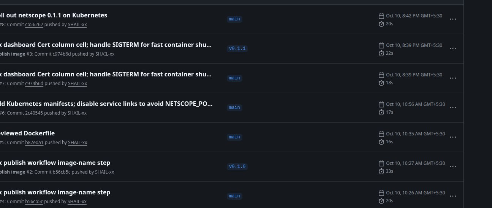

# netscope

[](https://github.com/SHAIL-xx/netscope/actions/workflows/ci.yml)

A website health checker written in pure Python (standard library only, no runtime dependencies).
It visits each URL the way a browser would and times every stage of the request, checks security
headers and TLS certificate expiry, and publishes the results as a live dashboard and as
Prometheus metrics.



## What it measures

- **Timing per stage:** DNS lookup, TCP connect, TLS handshake, time to first byte (TTFB) and total time,
  so a slow check shows *which* stage was slow.
- **Security headers:** HSTS, X-Content-Type-Options, X-Frame-Options, Content-Security-Policy and Cache-Control.
- **TLS certificate:** days until the certificate expires (HTTPS targets).
- **State:** up or down, with the error message when a check fails.

## Architecture



Delivery pipeline:



## Quick start

**Command line** (Python 3.12 or newer):

```bash
pip install -e .
netscope --once github.com                    # one report, then exit
netscope github.com example.com --interval 5  # watch mode: dashboard and /metrics on http://127.0.0.1:8000/
```

**Docker** (public image):

```bash
docker run --rm --init -p 127.0.0.1:8000:8000 \
  -e NETSCOPE_TARGETS=github.com,example.com \
  ghcr.io/shail-xx/netscope:0.1.1
```

**With Prometheus and Grafana** (Docker Compose):

```bash
docker compose up -d --build
```

| Service | URL |
|---|---|
| netscope dashboard | http://127.0.0.1:8000/ |
| Prometheus (alerts at `/alerts`) | http://127.0.0.1:9090/ |
| Grafana (`admin` / `admin`, dashboard "netscope") | http://127.0.0.1:3000/ |

**Kubernetes** (local cluster with [kind](https://kind.sigs.k8s.io/)):

```bash
kind create cluster --name netscope
kubectl apply -f k8s/
kubectl -n netscope port-forward service/netscope 8002:8000   # then open http://127.0.0.1:8002/
```

## Configuration

Every setting can be a command-line flag or an environment variable. A flag wins over the variable.

| Environment variable | Flag | Default | Meaning |
|---|---|---|---|
| `NETSCOPE_TARGETS` | URLs as arguments | none | Comma-separated URLs (`https://` is assumed if missing) |
| `NETSCOPE_INTERVAL` | `--interval` | `10` | Seconds between checks |
| `NETSCOPE_PORT` | `--port` | `8000` | Port for the dashboard and metrics |
| `NETSCOPE_HOST` | `--host` | `127.0.0.1` | Address to listen on (`0.0.0.0` in containers) |
| `NETSCOPE_TIMEOUT` | `--timeout` | `10` | Socket timeout in seconds |
| | `--once` | off | Check once, print a report, exit non-zero if a check failed |

## Endpoints and metrics

| Endpoint | Purpose |
|---|---|
| `/` | Live dashboard (refreshes every 3 s) |
| `/api/status` | The same data as JSON |
| `/metrics` | Prometheus metrics |
| `/healthz` | Liveness: the process is alive |
| `/readyz` | Readiness: `503` until every target has been checked once |

| Metric | Type | Labels |
|---|---|---|
| `netscope_requests_total`, `netscope_errors_total` | counter | `url` |
| `netscope_status_code` | gauge | `url` |
| `netscope_stage_ms` | gauge | `url`, `stage` (dns, connect, tls, ttfb, total) |
| `netscope_header_present` | gauge | `url`, `header` |
| `netscope_cert_expiry_days` | gauge | `url` |
| `netscope_request_duration_ms` | histogram | `url`, `le` |

## Alert rules

Defined in `monitoring/prometheus/alerts.yml` and visible in the Prometheus UI.

| Alert | Fires when |
|---|---|
| `SiteDown` | 3 or more failed checks in 2 minutes, for 1 minute |
| `CertExpiringSoon` | certificate has fewer than 14 days left, for 1 minute |
| `SlowChecks` | 3 or more checks took over 1 second in the last 15 minutes |





## Kubernetes details

The manifests in `k8s/` create a namespace, a ConfigMap (targets and interval), a Deployment and a Service.
The Deployment uses `/healthz` as the liveness probe and `/readyz` as the readiness probe, has CPU and memory
requests and limits, and runs as a non-root user with a read-only root filesystem, no Linux capabilities and no
privilege escalation. The image is pulled from GHCR.

## Testing and CI

```bash
python -m unittest discover -s tests       # 29 tests
python scripts/check_tests_collected.py    # fails if a test is defined but never collected
```

GitHub Actions runs three jobs on every push: the tests on Python 3.12 and 3.14, a container smoke test
(`scripts/smoke_test.py`), and validation of the Compose file, the Prometheus config and alert rules (`promtool`)
and the Grafana dashboard JSON. Pushing a tag such as `v0.1.1` builds the image, smoke-tests it and publishes it to GHCR.



## Lessons learned

- **Prometheus 3 rewrites `le="1000"` to `le="1000.0"`.** An alert rule using the integer form passed
  `promtool` but matched nothing, so it could never fire. Queries on histogram buckets must use the float form.
- **A container's main process ignores SIGTERM unless the program handles it.** Pods running version 0.1.0 took
  31 s to delete (the full grace period); with a SIGTERM handler in 0.1.1 it takes 0.4 s.
- **Kubernetes injects environment variables for every Service in the namespace.** A Service named `netscope` created
  `NETSCOPE_PORT=tcp://...`, which collided with the app's own `NETSCOPE_PORT` setting. The Deployment sets
  `enableServiceLinks: false`.
- **A passing test run can hide a missing test.** A mis-indented test method was silently never collected, which is
  why `scripts/check_tests_collected.py` compares defined and collected counts.

## Limitations

- Checks use HTTP/1.1 and do not follow redirects.
- Results are kept in memory, so history comes from Prometheus.
- Alerts appear in the Prometheus UI only. There is no Alertmanager, so no notifications are sent.
- The web server handles one request at a time, which is enough for a dashboard and a scraper but not for heavy traffic.

## Project layout

```
src/netscope/        the application (cli.py holds the checker, metrics and dashboard)
tests/               unit and regression tests
scripts/             CI helpers: test-count guard and container smoke test
k8s/                 Kubernetes manifests
monitoring/          Prometheus config, alert rules, Grafana provisioning and dashboard
docker-compose.yml   netscope + Prometheus + Grafana
Dockerfile           non-root image with a health check
.github/workflows/   CI and image publishing
```